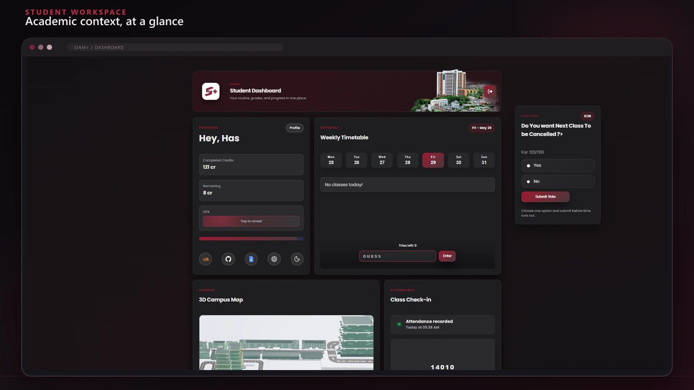
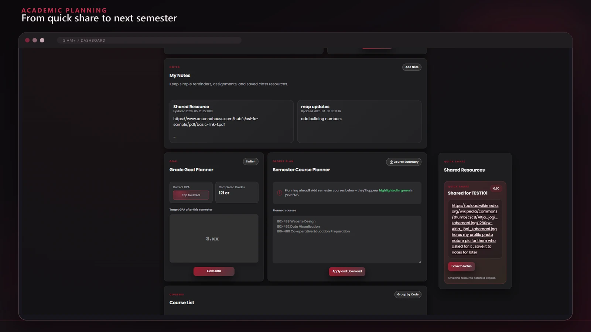
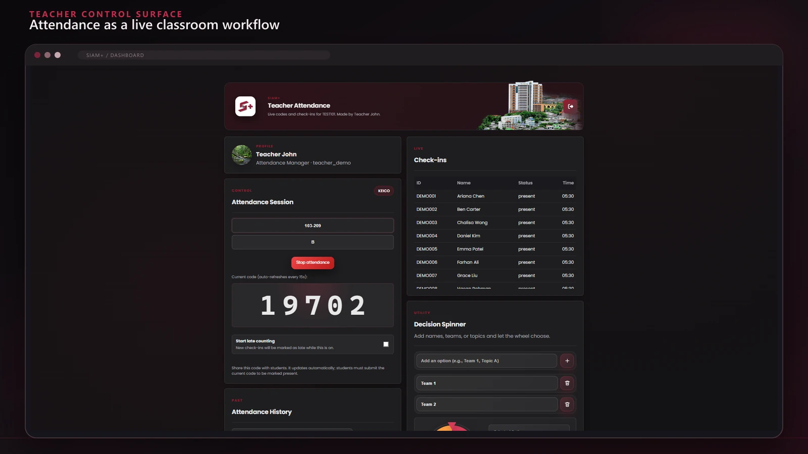
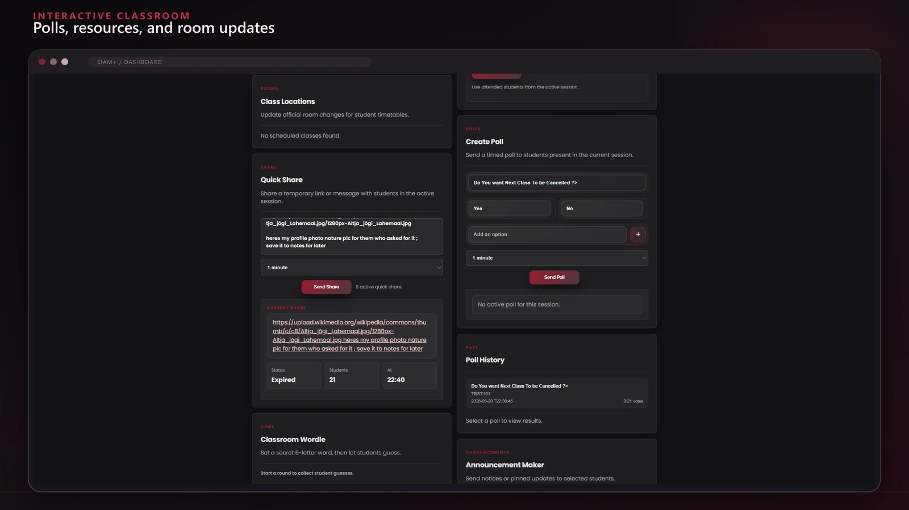
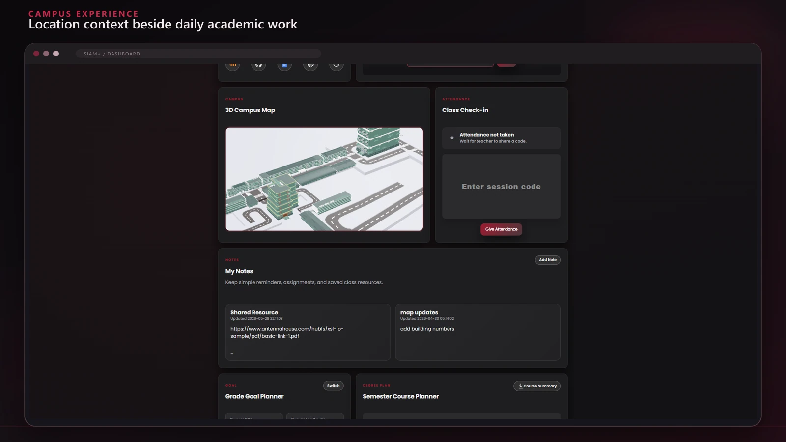

  

<h1 align="center">SIAM+</h1>

  <strong>A full-stack academic dashboard and classroom workflow prototype for students and teachers.</strong>

  
  
  
  
  

  <em>One connected workspace for academic progress, attendance, classroom communication, and planning.</em>

 

## What I built

SIAM+ is a substantial academic software prototype rather than a static dashboard mockup. It connects a student self-service experience with a teacher control surface: academic information is summarized for students, while classroom actions created by teachers appear as visible, stateful workflows on the student side.

The product brings together timetable and course information, GPA and credit progress, attendance sessions, live polls, temporary resource sharing, notes, announcements, room updates, academic planning, and a prototype 3D campus view. The screenshots below are genuine application captures from the project; the implementation source remains private.

## Student experience

The student home surface is designed for fast daily scanning. It combines the profile and academic overview with weekly classes, course context, credit progress, a privacy-aware GPA display, active attendance awareness, and classroom prompts. The documented feature set also includes completed, remaining, graded, and transfer credits; degree progress; grouped course records; course search/filtering; student poll responses; and announcements or room updates.

 

Planning and follow-through continue beyond the home view. Students can work with grade goals, semester and course planning, personal reminders, grouped course lists, and saved classroom resources. A teacher's temporary quick share can show an active countdown state and be saved directly into notes, turning a short-lived classroom message into something the student can revisit.

## Teacher experience

 

The teacher attendance surface shows the operational depth of the project. A teacher can create an attendance session, display a generated code, monitor student check-ins, handle present or late states, use a late-attendance mode, stop and review session history, and export records as CSV. The interface is organized around active classroom state instead of a generic administration table.

 

The companion control surface groups timed poll creation, response options, poll history, quick-share resources, expiration states, announcements, room/building updates, and lightweight classroom activities such as a decision spinner or random team generation. Giving these tools one coherent workflow is a core product decision: teachers can coordinate a class without switching between unrelated utilities.

## Interactive classroom and campus context

 

## Campus experience

The student map/attendance/notes view connects physical campus context with classroom work. It demonstrates the interactive 3D campus-map prototype, attendance-code submission, active or waiting attendance states, personal notes, saved resources, and academic reminders. Across the interfaces, clear active, waiting, saved, present, late, and privacy states make the workflows understandable at a glance. Clipboard/copy actions and download/export actions support the practical moments where information must leave the dashboard.

## Engineering highlights

The verified project documentation identifies a Python and Flask backend with server-side routes and APIs, session handling, dynamic JavaScript interfaces, responsive HTML/CSS layouts, Selenium-based university SIS integration, academic data extraction and processing, GPA/credit calculations, cached academic data, JSON-backed prototype persistence, and CSV generation/download. The screenshots directly evidence the student and teacher interfaces; the SIS, calculation, caching, persistence, and export behaviors are documented capabilities rather than independently source-verified here.

Three engineering problems are especially visible in the product:

1. **Turning academic records into decisions.** Raw timetable, grade, and credit information is shaped into progress summaries, GPA visibility controls, grouped course views, grade goals, and semester planning.
2. **Managing shared classroom state.** Attendance sessions, late status, timed polls, expiring quick shares, announcements, and room updates need coordinated student and teacher states rather than isolated pages.
3. **Making prototype data useful and inspectable.** Cached academic data, lightweight persistence, copy/save interactions, and CSV export support repeated classroom use while keeping the academic prototype understandable to review.

The documentation and screenshots support these capabilities, but they do not claim production scale, institutional deployment, or performance guarantees. The 3D map and some classroom utilities are explicitly prototype-oriented; live SIS behavior and private implementation details are not independently verifiable from this public repository.

## My contribution

I developed SIAM+ as an end-to-end academic software engineering prototype: shaping the product concept, designing the dark academic-dashboard system, building the student and teacher experiences, connecting the academic and classroom workflows, and implementing the documented backend/data-processing behaviors. The verified stack is **Python, Flask, Selenium, HTML, CSS, JavaScript, and JSON**.

This repository is a public portfolio showcase. It contains genuine UI evidence without private source, credentials, student records, or sensitive SIS implementation details.

## Project context

SIAM+ was developed as an academic software engineering project at Siam University for the Bachelor of Science in Information Technology program. The private implementation is available only to authorized reviewers.

  <strong>Hasan Al Maher Rafi</strong> 
  B.Sc. Information Technology | Siam University 
  <a href="https://github.com/poralekhamaher">GitHub</a>

